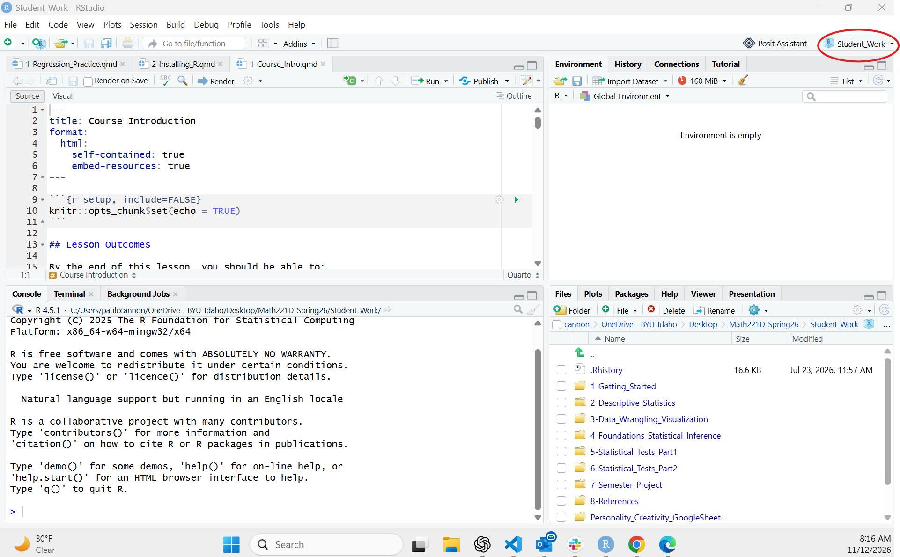
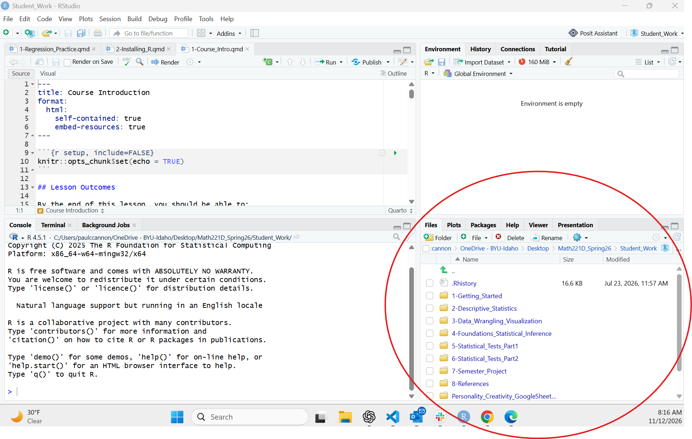
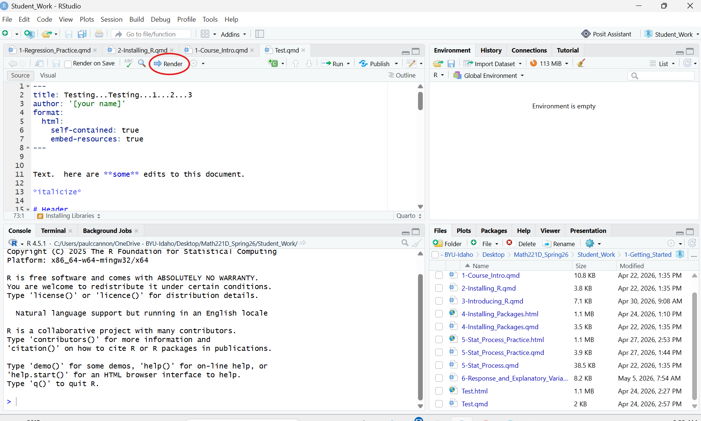
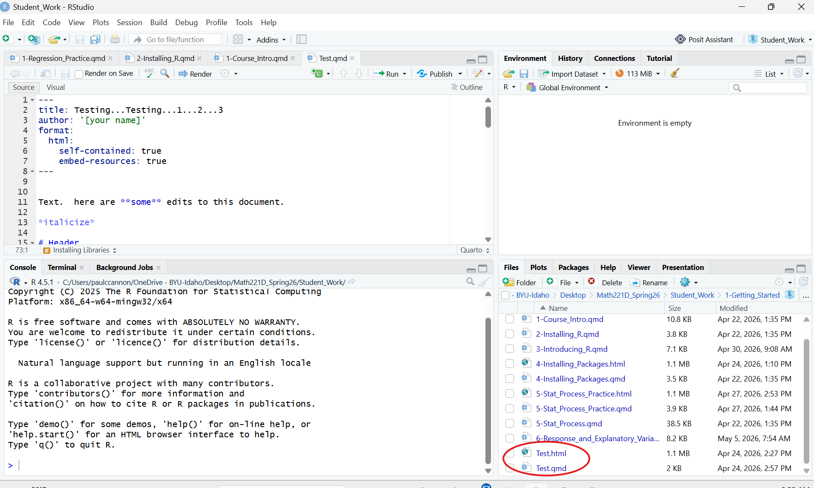

# Install R and RStudio

R is the software that runs your analyses. RStudio is the desktop app where you write and run R code. Install R first, then install RStudio.

## Choose your computer

Follow the instructions for your computer. Install R first, then install RStudio Desktop.

::: {.panel-tabset}

### Windows

#### 1. Install R

Download R from [CRAN for Windows](https://cran.r-project.org/bin/windows/base/) and run the installer. The default installation choices are fine.

#### 2. Install RStudio Desktop

Download [RStudio Desktop](https://docs.posit.co/ide/user/download.html). Choose the Windows `.exe` installer, run it, and accept the default choices.

### Mac

#### 1. Install R

**Which Mac processor do you have?**

Macs use either Apple silicon (M-series) or Intel processors. R has a different installer for each, so choose the one that matches your Mac. To find out which, open:  

 **Apple menu > About This Mac**
 
 If the window says **Chip** and lists an M-series chip, download the `arm64` package. 
 
 If it says **Processor** and lists Intel, download the `x86_64` package. Open the downloaded `.pkg` installer.

#### 2. Install RStudio Desktop

Download [RStudio Desktop](https://docs.posit.co/ide/user/download.html) and choose the macOS `.dmg` installer. Open the downloaded file and drag RStudio to Applications. You do not need to choose a processor type for RStudio. The download page lists the current operating system requirements.

### Chromebook/Tablet

If you are using a Chromebook or tablet, you can set up a free account on [Posit Cloud](https://posit.cloud/) and run RStudio in your browser. You do not need to install any software locally. Follow the course instructions for opening the course files in Posit Cloud.

Use [Posit Cloud](https://posit.cloud/) in your browser instead of installing software locally. Follow the course instructions for opening the course files in Posit Cloud.  

:::

## Create an R Project

Once you have R and RStudio installed, you will create an R Project to organize your work. An R Project is a folder that contains all of your course files and keeps them organized. 

1. Create an easy-to-find folder, such as `Stat225`.  
2. [Download the course files](https://raw.github.com/byuistats/Math221D_Course/main/Student_Work.zip), unzip the folder, and move the `Student_Work` folder into your course folder.  
3. Open RStudio and click **File > New Project > Existing Directory**. Click "Browse" and navigate to your course folder and select it. Click **Create Project**. You should see the course files in the Files pane of RStudio.  

In the top right corner of RStudio, you should see the name of your course folder. This is the name of your R Project. You can click the down arrow next to it to see a list of all your R Projects and switch between them.  

## Check your installation

Open RStudio and check that your Project is open by looking at the top right corner of RStudio. You should see the name of your course folder. 

If you do not see your course folder, click **File > Open Project** and navigate to your course folder to open it.  

All the folders in Student_Work should be visible in the Files pane of RStudio. 

1. Click on 1-Getting_Started in the Foler window.  
2. Click on the `Test.qmd` file which should open up some strange looking file in the main editor window.  
3. Click the **Render** button at the top of the editor window. 

This will create a new file called `Test.html` in the folder window.  

If everything worked out, submit the `Test.html` file in Canvas. 

If you were unable to get things working, don't stress.  We will have time in class to troubleshoot setup issues.  

__NOTE__:  You will not be penalized for turning this assignment in late.  The purpose of this assignment is to make sure your technology is set up so that we can focus on learning the material in class.  

## Learning by Faith

Most of you will have absolutely no idea what you just did. That's totally **normal**.  

Take a deep breath.  Be patient.  I promise it will all make sense soon.  

The important thing for now is that your technology for the course is up and running.  